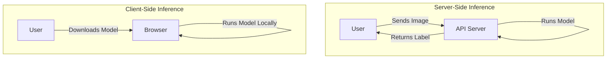

# MACHINE LEARNING FUNDMENTALS

**Session Time:** 120 minutes

---

## Table of Contents

1. Machine Learning in the Browser
2. The ML Pipeline: Preprocessing & Tensors
3. Client-Side Inference with TensorFlow.js
4. Model Deployment Strategies
5. Lab: Running Models with TensorFlow.js
6. Wrap-Up and Reflection
7. Resources

---

## Module Overview

In this module, learners study the basics of machine learning — data preprocessing, inference, and model deployment — as applied in web systems. Unlike traditional ML which runs on heavy backend servers using Python, this module explores how to bring intelligence directly into the browser using JavaScript. We will focus on using pre-trained models to perform tasks like image classification without needing to manage complex server infrastructure.

---

## Learning Objectives

By the end of this module, participants will be able to:

1. **Describe and apply fundamental ML concepts** relevant to integrating AI into web applications, specifically focusing on the difference between training and inference.
2. **Explain the role of Tensors** in data representation and perform basic data preprocessing for web-based models.
3. **Deploy and execute** a pre-trained machine learning model in the browser using TensorFlow.js to classify images or text.

---

## Session Breakdown

| Segment | Topic | Duration (minutes) |
| --- | --- | --- |
| 1 | Machine Learning in the Browser | 20 |
| 2 | The ML Pipeline: Preprocessing & Tensors | 30 |
| 3 | Client-Side Inference with TensorFlow.js | 20 |
| 4 | Model Deployment Strategies | 20 |
| 5 | Lab: Running Models with TensorFlow.js | 30 |

---

## 1. Machine Learning in the Browser

Traditionally, Machine Learning (ML) happens on powerful servers. However, modern libraries like **TensorFlow.js** allow ML to run directly in the user's web browser (Client-side).

### Why do ML in the browser?

* **Privacy:** Data (like webcam images or text input) never leaves the user's device.
* **Low Latency:** No need to send data to a server and wait for a response; inference happens instantly.
* **Cost:** Reduces server costs since the computation is offloaded to the user's device.

### Concepts: Training vs. Inference

* **Training:** The heavy-lifting phase where a model learns from data (usually done in Python/Cloud).
* **Inference:** The usage phase where the model makes predictions on new data (can be done easily in JavaScript/Browser).

> **Note:** In this module, we focus on **Inference**—using models that have already been trained to add intelligence to our web apps.

---

## 2. The ML Pipeline: Preprocessing & Tensors

Before a model can "see" an image or "read" text, the data must be converted into a format it understands: numbers.

### Tensors

A **Tensor** is the fundamental data structure in ML. It is essentially a multi-dimensional array.

* **Scalar:** A single number (0 dimensions).
* **Vector:** A list of numbers (1 dimension).
* **Matrix:** A grid of numbers (2 dimensions).
* **Tensor:** A grid with -dimensions (e.g., an image is Height x Width x Color Channels).

### Preprocessing Steps

1. **Input:** Raw data (e.g., a `.jpg` image).
2. **Resizing:** Models expect fixed sizes (e.g., 224x224 pixels).
3. **Normalization:** Converting pixel values from 0-255 to 0-1 (floats) for faster math.
4. **Tensor Conversion:** Turning the array into a TensorFlow object.


---

## 3. Client-Side Inference with TensorFlow.js

**TensorFlow.js** is a library developed by Google for running ML in JavaScript. It leverages the computer's GPU (Graphics Processing Unit) via WebGL to run math operations fast.

### The Workflow

1. **Load the Library:** Include the CDN link.
2. **Load the Model:** Fetch the `model.json` and weight files (shards).
3. **Predict:** Pass the tensor to `model.predict()`.

### Example: Loading MobileNet

MobileNet is a small, efficient model designed for mobile and web devices. It can classify 1,000 different types of objects (like "coffee mug," "golden retriever," etc.).

```javascript
// 1. Load the model
const model = await mobilenet.load();

// 2. Select the HTML image element
const img = document.getElementById('myImage');

// 3. Classify (Inference)
const predictions = await model.classify(img);

console.log('Predictions: ', predictions);
// Output: [{ className: "Egyptian cat", probability: 0.89 }, ...]

```

---

## 4. Model Deployment Strategies

When building AI web apps, you must decide *where* the "brain" lives.

| Strategy | Description | Pros | Cons |
| --- | --- | --- | --- |
| **Server-Side (API)** | The model runs on your backend (Node.js/Python). | Secure logic, can run massive models. | High latency, server costs, privacy concerns. |
| **Client-Side (Browser)** | The model runs in the user's Chrome/Firefox. | Instant results, free compute, high privacy. | Limited by device power, model size must be small. |

### Diagram: Architecture Comparison



---

## 5. Lab: Running Models with TensorFlow.js

**Objective:** Use TensorFlow.js to run a simple in-browser model for image or text classification.

In this lab, you will build a web page that uses your computer's webcam to identify objects in real-time.

### Setup

* Create an `index.html` file.
* You do not need a backend server; this can run locally.

### Step 1: Include Scripts

Add the TensorFlow.js and MobileNet script tags to your HTML `<head>`.

```html
<script src="https://cdn.jsdelivr.net/npm/@tensorflow/tfjs"></script>
<script src="https://cdn.jsdelivr.net/npm/@tensorflow-models/mobilenet"></script>

```

### Step 2: The UI

Add an image tag and a button.

```html

<button onclick="identifyImage()">Identify Object</button>
<div id="result"></div>

```

### Step 3: The Logic

Write the JavaScript to load the model and run inference.

```javascript
async function identifyImage() {
    const statusDiv = document.getElementById('result');
    statusDiv.innerText = "Loading model...";

    // Load the model
    const model = await mobilenet.load();
    
    // Get the image
    const imgElement = document.getElementById('img');
    
    // Classify
    const predictions = await model.classify(imgElement);
    
    // Display result
    statusDiv.innerText = `I think this is a: ${predictions[0].className} 
                           (${Math.round(predictions[0].probability * 100)}% sure)`;
}

```

### Challenge

Switch the input from a static image (``) to a live webcam feed using the `<video>` element and `navigator.mediaDevices.getUserMedia()`.

---

## 6. Wrap-Up and Reflection

**Reflection Questions:**

1. Why is **normalization** (converting pixels to 0-1) important for the model's performance?
2. If you were building a "Medical Diagnosis" app, would you run it Client-Side or Server-Side? Why? (Consider privacy vs. model accuracy).

---

## 7. Resources

* [TensorFlow.js Documentation](https://www.tensorflow.org/js)
* [TensorFlow Hub (Pre-trained Models)](https://tfhub.dev/)
* [MobileNet Github Repository](https://github.com/tensorflow/tfjs-models/tree/master/mobilenet)