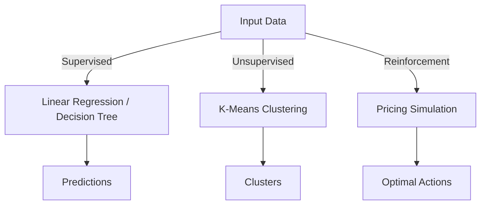
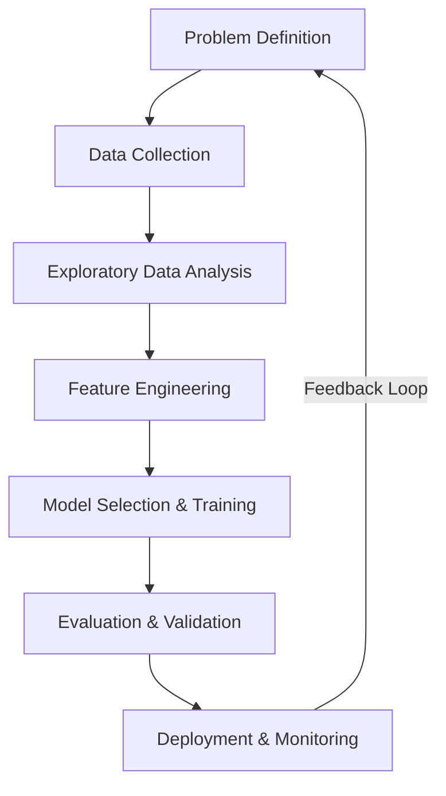
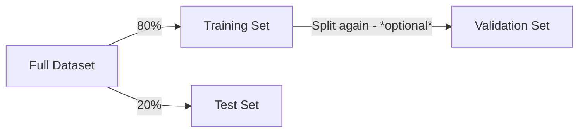
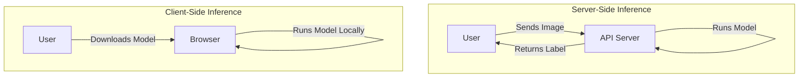

# MACHINE LEARNING FUNDMENTALS

**Session Time:** 120 minutes

---

## Table of Contents

1. Machine Learning Intro
2. Introduction to Machine Learning Types
3. The End-to-End AI/ML Workflow
4. Data Splitting & Model Validation
5. Model Training and Evaluation Metrics
6. Machine Learning in the Browser
7. The ML Pipeline: Preprocessing & Tensors
8. Client-Side Inference with TensorFlow.js
9. Model Deployment Strategies
10. Lab: Running Models with TensorFlow.js
11. Wrap-Up and Reflection
12. Resources

---

## Module Overview

In this module, learners study the basics of machine learning — data preprocessing, inference, and model deployment — as applied in web systems.

---

## Learning Objectives

By the end of this module, participants will be able to:

1. **Describe and apply fundamental ML concepts** relevant to integrating AI into web applications, specifically focusing on the difference between training and inference.
2. **Explain the role of Tensors** in data representation and perform basic data preprocessing for web-based models.
3. **Deploy and execute** a pre-trained machine learning model in the browser using TensorFlow.js to classify images or text.

---

## Session Breakdown

| Segment | Topic | Duration (minutes) |
| --- | --- | --- |
| 1 | Machine Learning Intro & Types | 40 |
| 2 | The ML Pipeline: Preprocessing & Tensors | 20 |
| 3 | Client-Side Inference with TensorFlow.js | 20 |
| 4 | Model Deployment Strategies | 20 |
| 5 | Lab: Running Models with TensorFlow.js | 20 |

---

## 1. Machine Learning Intro

### Fundamental concepts of machine learning 

> Machine Learning (ML) enables systems to learn patterns from data instead of being explicitly programmed. 
> 
> ML is the foundation that powers modern AI applications, and understanding its algorithms, strengths, and limitations is critical for designing effective web solutions.

**Practical Example:** 
<br>Instead of writing hundreds of `if/else` statements to guess if a user will cancel their subscription, you feed historical customer data into a Decision Tree Classifier. The model learns the rules automatically and outputs a prediction that your web backend can use to offer a discount.

### Phases of the industrial AI/ML workflow (MLOps).
> Building an ML feature is not just about writing an algorithm; it requires a structured lifecycle. 
> 
> This involves problem definition, data collection, exploratory data analysis (EDA), feature engineering, model selection, evaluation, and finally, deployment and monitoring. 

**Practical Example:**
<br>If your business objective is to "increase revenue," you must first identify the ML task (e.g., a recommendation engine), determine success metrics, and assess data availability before ever writing model code.

### Impact of data splitting and model validation
> A well-validated model ensures reliable performance in real-world scenarios. 
> 
> You must divide your dataset into subsets to prevent the model from simply "memorizing" the training data, a problem known as overfitting.

**Practical Example:** 
<br>When building a house price predictor, you train the model on 80% of your data (Training Set) and test its accuracy on the remaining 20% (Test Set) that the model has never seen before.

### Evaluating model performance
> Building an ML model is only half the battle; evaluating its performance is critical to ensuring it makes accurate predictions in real-world applications. Without proper evaluation, models may provide misleading results or fail to meet business objectives.

**Practical Example:**
<br>In an application predicting a rare disease, a model might achieve 99% accuracy by simply predicting "no disease" for every patient. You must recognize that Precision, Recall, or an F1-score would reveal the model's true (and likely poor) performance in this imbalanced dataset.

---

## 2. Introduction to Machine Learning Types

When integrating ML into web systems, you generally work with three main categories of algorithms:

| Type | Description | Example |
|---|---|---|
| **Supervised Learning** | Learns from labeled data (inputs mapped to known outputs). | Email spam classification, House price prediction. |
| **Unsupervised Learning** | Finds hidden patterns/structures in unlabeled data. | Customer segmentation, anomaly detection. |
| **Reinforcement Learning** | Learns by receiving rewards or penalties (trial and error). | Game-playing AI, robotics navigation. |



---

## 3. The End-to-End AI/ML Workflow

A typical ML workflow consists of the following stages:

* **Problem Definition & Business Understanding** - Define the goal, constraints, and success criteria.
* **Data Collection & Preprocessing** - Gather and clean data for modeling.
* **Exploratory Data Analysis (EDA)** - Understand the dataset through statistics and visualizations.
* **Feature Engineering** - Select and transform relevant features for better model performance.
* **Model Selection & Training** - Choose and train an appropriate model.
* **Evaluation & Validation** - Measure model performance using appropriate metrics.
* **Deployment & Monitoring** - Deploy and continuously monitor model performance.



---

## 4. Data Splitting & Model Validation

To ensure your model generalizes well to unseen data, you must divide your dataset into subsets:

* **Training Set** — Used to train the model.
* **Validation Set** (optional) — Used for hyperparameter tuning.
* **Test Set** — Used to evaluate the model's final performance.

### Cross-Validation

Cross-validation (CV) is a more robust method than a simple train-test split, as it helps mitigate variance in performance evaluation.

* **K-Fold Cross-Validation** — Splits data into K subsets and trains the model multiple times.
* **Stratified K-Fold** — Ensures that class distributions remain balanced across folds.



---

## 5. Model Training and Evaluation Metrics

Choosing the right evaluation metric depends heavily on the type of ML task and the data characteristics.

| **ML Task** | **Common Metrics** | **When to Use** |
| --- | --- | --- |
| **Classification** | Accuracy, Precision, Recall, F1-score | When predicting categories (spam detection, fraud detection) |
| **Regression** | Mean Squared Error (MSE), R², MAE | When predicting continuous values (house prices, sales forecasts) |

**Common Pitfalls:**

* **High Accuracy in Imbalanced Datasets:** As mentioned, 99% accuracy is misleading if the model is just guessing the majority class.
* **MSE with Outliers:** Predicting house prices with luxury mansions in the dataset will cause a high MSE despite good predictions for typical houses. Mean Absolute Error (MAE) is often a better metric here.
* **Perfect Precision but Poor Recall:** A fraud detection system that only flags extremely obvious cases might have 100% precision but miss most actual fraud cases.

---

## 6. Machine Learning in the Browser

Traditionally, Machine Learning (ML) happens on powerful servers. However, modern libraries like **TensorFlow.js** allow ML to run directly in the user's web browser (Client-side).

### Why do ML in the browser?

* **Privacy:** Data (like webcam images or text input) never leaves the user's device.
* **Low Latency:** No need to send data to a server and wait for a response; inference happens instantly.
* **Cost:** Reduces server costs since the computation is offloaded to the user's device.

### Concepts: Training vs. Inference

* **Training:** The heavy-lifting phase where a model learns from data (usually done in Python/Cloud).
* **Inference:** The usage phase where the model makes predictions on new data (can be done easily in JavaScript/Browser).

> **Note:** In this module, we focus on **Inference**—using models that have already been trained to add intelligence to our web apps.

---

## 7. The ML Pipeline: Preprocessing & Tensors

Before a model can "see" an image or "read" text, the data must be converted into a format it understands: numbers.

### Tensors

A **Tensor** is the fundamental data structure in ML. It is essentially a multi-dimensional array.

* **Scalar:** A single number (0 dimensions).
* **Vector:** A list of numbers (1 dimension).
* **Matrix:** A grid of numbers (2 dimensions).
* **Tensor:** A grid with -dimensions (e.g., an image is Height x Width x Color Channels).

### Preprocessing Steps

1. **Input:** Raw data (e.g., a `.jpg` image).
2. **Resizing:** Models expect fixed sizes (e.g., 224x224 pixels).
3. **Normalization:** Converting pixel values from 0-255 to 0-1 (floats) for faster math.
4. **Tensor Conversion:** Turning the array into a TensorFlow object.


---

## 8. Client-Side Inference with TensorFlow.js

**TensorFlow.js** is a library developed by Google for running ML in JavaScript. It leverages the computer's GPU (Graphics Processing Unit) via WebGL to run math operations fast.

### The Workflow

1. **Load the Library:** Include the CDN link.
2. **Load the Model:** Fetch the `model.json` and weight files (shards).
3. **Predict:** Pass the tensor to `model.predict()`.

### Example: Loading MobileNet

MobileNet is a small, efficient model designed for mobile and web devices. It can classify 1,000 different types of objects (like "coffee mug," "golden retriever," etc.).

```javascript
// 1. Load the model
const model = await mobilenet.load();

// 2. Select the HTML image element
const img = document.getElementById('myImage');

// 3. Classify (Inference)
const predictions = await model.classify(img);

console.log('Predictions: ', predictions);
// Output: [{ className: "Egyptian cat", probability: 0.89 }, ...]

```

---

## 9. Model Deployment Strategies

When building AI web apps, you must decide *where* the "brain" lives.

| Strategy | Description | Pros | Cons |
| --- | --- | --- | --- |
| **Server-Side (API)** | The model runs on your backend (Node.js/Python). | Secure logic, can run massive models. | High latency, server costs, privacy concerns. |
| **Client-Side (Browser)** | The model runs in the user's Chrome/Firefox. | Instant results, free compute, high privacy. | Limited by device power, model size must be small. |

### Diagram: Architecture Comparison



---

## 10. Lab: Running Models with TensorFlow.js

**Objective:** Use TensorFlow.js to run a simple in-browser model for image or text classification.

**Refer**: [**Running Models with TensorFlow.js**](https://github.com/ga-curriculum/lab5-running-models-with-tensorflow.js)

---

## 11. Wrap-Up and Reflection

**Reflection Questions:**

1. Why is **normalization** (converting pixels to 0-1) important for the model's performance?
2. If you were building a "Medical Diagnosis" app, would you run it Client-Side or Server-Side? Why? (Consider privacy vs. model accuracy).

---

## 12. Resources

* [TensorFlow.js Documentation](https://www.tensorflow.org/js)
* [TensorFlow Hub (Pre-trained Models)](https://tfhub.dev/)
* [MobileNet Github Repository](https://github.com/tensorflow/tfjs-models/tree/master/mobilenet)